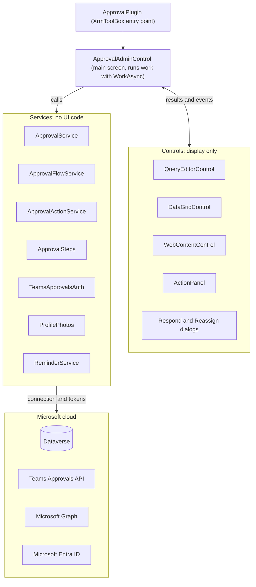
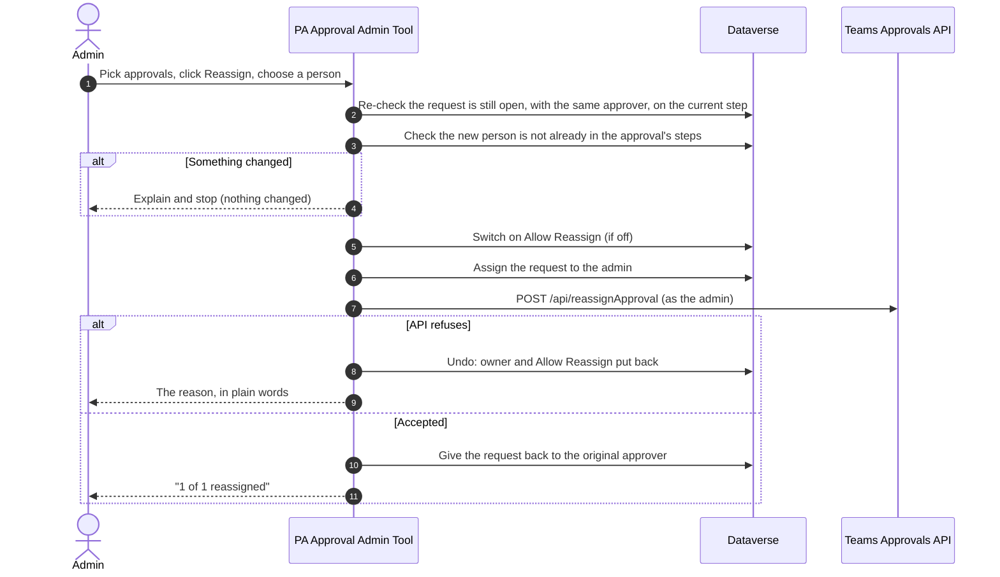

# PA Approval Admin Tool

An [XrmToolBox](https://www.xrmtoolbox.com/) tool for administering **Power Automate approvals** stored in Dataverse.
It lets an administrator find approvals, see who an approval is with and where it is up to, **approve, reject,
reassign or cancel** approvals on behalf of the people they were sent to, and **remind** approvers in Teams, one at a
time or many at once.


## Contents

- [Purpose](#purpose)
- [Features](#features)
- [Getting started](#getting-started)
- [Architecture](#architecture)
- [How an action works](#how-an-action-works)
- [Design decisions and rationale](#design-decisions-and-rationale)
- [Known limitations](#known-limitations)
- [Building from source](#building-from-source)
- [Tests](#tests)
- [Credits](#credits)
- [License](#license)

## Purpose

Power Automate approvals get stuck. The approver is on leave, has left the company or is sitting on the request, or
the flow that started the approval has been switched off. Power Automate has no admin screen for this: an approval can
only be answered by the person it was sent to, and only a few of them can be reassigned or cancelled from the Power
Automate portal.

The approval records live in Dataverse (`msdyn_flow_approval`, `msdyn_flow_approvalrequest`,
`msdyn_flow_approvalresponse`), but editing those rows directly does not work. The flow waiting on the approval is not
told, Teams and Outlook cards are not updated, and the approval can end up half finished.

This tool gives administrators that missing screen. It reads the approvals from Dataverse and acts on them through the
same service Teams and Power Automate use, so flows carry on and every card stays in step.

## Features

**Find approvals**

- A grid of the environment's approvals, built from the approval table's own metadata (column names and hover-text
  definitions).
- An editable FetchXML **filter** (only the `<filter>` part can be changed), syntax-coloured and checked as you type.
- Excel-style column filters, sorting, and a switch on choice and lookup columns between the readable value and the
  value stored in Dataverse.
- A **Currently With** column: who the approval is waiting on right now. Approvals that wait for everyone's response
  show N/A here, because their answered requests stay open until the approval finishes (see below). Custom-response
  approvals that wait for all responses list the people who have not responded yet.

**Understand an approval**

- A preview pane with the approval's details, rendered from the Markdown written in the flow.
- A left-to-right **approval flow chart**: the requester, then each step with the people it went to. Each person shows
  their Microsoft 365 profile photo (or initials), name and job title, and where they stand (approved, rejected,
  waiting, not started, no response). "Currently with" points at whoever the approval is waiting on.

**Act on approvals**

- **Approve** or **Reject** on behalf of the approver. The comment starts filled in with who did it, for example
  "Approved by Ada Admin (administrator) on the approver's behalf, using PA Approval Admin Tool.", so the approval's
  history records it. You can change it.
- **Custom responses.** Approve and Reject mean nothing for approvals with their own responses (such as "Book it" or
  "Ask me later"), so when one is chosen the panel shows a single **Action** button instead. Its window has a dropdown
  per approval to pick the response, and its send button shows the response picked ("Send responses" if they differ).
- **Reassign** to someone else in the environment.
- **Cancel** an open approval, with the comment attached to it.
- **Remind** the approver with a Teams chat message from you: the approval's title, your note and a link to their
  approvals. If your sign-in may not send chats, it is emailed from your mailbox instead. Nothing in the approval
  changes.
- Tick several approvals to act on all of them at once. If an approval waits on several people, you choose whose
  requests the action applies to.
- Sequential (multi-step) approvals are understood: actions only touch the step the approval is on.
- **"Everyone must approve" approvals**: the window lists who has responded (and how) and who is still to respond, and
  the actions only offer the requests still waiting.
- Buttons are disabled when there is nothing to act on, including approvals that are completed, cancelled, expired or
  abandoned.

**Safety**

- **System Administrators only.** The tool checks your security roles when it connects (given directly or through a
  team). Without the System Administrator role every action button is disabled, with the reason shown under them.
- **Borrowed rows are tracked.** Actions briefly assign a row to you (see below). Each one is recorded in the tool's
  settings until it is given back. If XrmToolBox closes in the middle of an action, the tool offers to give those rows
  back the next time you connect to that environment.

## Getting started

1. Install **PA Approval Admin Tool** from the XrmToolBox Tool Library.
2. Connect to an environment that uses Power Automate approvals. Your account needs the **System Administrator**
   role in that environment. Without it you can browse approvals, but the action buttons are disabled.
3. Open the tool. Approvals load into the grid, and selecting one shows it in the preview pane.
4. The first time you approve, reject, reassign or cancel, you sign in to Microsoft once more, for the Teams
   Approvals service. That sign-in is saved (encrypted for your Windows account), so it is not asked for again.
   Remind uses the same sign-in for Microsoft Graph, and may ask once more the first time.

> **Your own app registration (optional).** By default the tool signs in as Microsoft's Teams client, so most tenants
> need no setup. If your tenant blocks that, the tool asks for the client ID of an Entra ID app registration: a public
> client with the redirect URI `https://login.microsoftonline.com/common/oauth2/nativeclient` and a delegated
> permission on the Approvals API.

## Architecture

The tool is a standard XrmToolBox plugin (.NET Framework 4.8, WinForms). The main control owns the connection and
hands work to services that contain no UI code. Controls only display data and raise events.



| Control | What it shows |
| --- | --- |
| `QueryEditorControl` | The FetchXML query, with only the filter editable |
| `DataGridControl` | The approvals grid, with column filters and tick boxes |
| `WebContentControl` | The approval's details and its flow chart |
| `ActionPanel` | The Approve, Reject, Reassign, Cancel and Remind buttons, and why they are disabled when you are not a System Administrator |
| `RespondDialog`, `ReassignDialog` | The windows that ask for a comment (and a response, for custom responses) and confirm an action |

| Service | Talks to |
| --- | --- |
| `ApprovalService`, `ApprovalFlowService` | Dataverse, through the XrmToolBox connection |
| `ApprovalActionService` | Dataverse, and the Teams Approvals API with the admin's token. Also the System Administrator check and giving back borrowed rows |
| `ApprovalSteps` | Nothing: the shared rule for which requests belong to the current step |
| `TeamsApprovalsAuth` | Microsoft Entra ID, to sign in for the Teams Approvals API (and silently for Graph) |
| `ProfilePhotos` | Microsoft Graph, for people's photos |
| `ReminderService` | Microsoft Graph, to send the approver a Teams chat message (or an email) |

### Folders

| Folder | What is in it |
| --- | --- |
| `ApprovalPlugin.cs` | The MEF export XrmToolBox discovers: name, description and icons. |
| `ApprovalAdminControl.cs` | The main screen. Owns the connection and settings, runs Dataverse work in the background with `WorkAsync`, and passes results to the controls. |
| `Models/` | `ApprovalColumns`: the one list of columns, used by both the query and the grid. Also column definitions (hover text) and readable values for choices and lookups. |
| `Services/` | All Dataverse, Teams Approvals and Graph work. No UI code, so it runs safely off the UI thread and can be tested with a fake `IOrganizationService`. |
| `Controls/` | The grid, query editor, preview pane, action panel and dialogs. They never call Dataverse. |
| `Settings.cs` | Saved settings: the optional client ID, the encrypted Teams Approvals sign-in, and rows borrowed by actions that have not been given back yet. |
| `Tests/` | Console test suites run against the built DLL with fakes, and the script that runs them. See [Tests](#tests). |

### Main data

| Table | Used for |
| --- | --- |
| `msdyn_flow_approval` | The approval: title, details, status, result, current step, Allow Cancel and Allow Reassign. |
| `msdyn_flow_approvalrequest` | One row per approver per step. An open request is what the approval is waiting on. |
| `msdyn_flow_approvalresponse` | The answers given, per step. |
| `systemuser` | Names, job titles and Entra object IDs (for photos and reminders), and the people you can reassign to. |
| `role`, `systemuserroles`, `teamroles`, `teammembership` | Whether you have the System Administrator role, directly or through a team. |
| `annotation` | The comment attached when an approval is cancelled. |

## How an action works

Every action follows the same pattern. Reassign is shown here.



## Design decisions and rationale

**Act through the Teams Approvals API, not by editing rows.**
Writing a response row or changing an owner in Dataverse does not resume the flow or update Teams and Outlook cards.
The Teams Approvals API is what Teams itself calls, so an approval answered by the tool behaves exactly like one
answered in Teams. The API is undocumented, which is the main risk in this tool. It is used carefully: every call is
checked, refused calls are explained, and any Dataverse change made before the call is undone.

**Borrow ownership, then give it back.**
The API only lets people act on rows they own. Rather than ask for an application identity with more power, the tool
briefly assigns the approver's request (or the approval, when cancelling) to the admin, calls the API as the admin, and
assigns it back. Afterwards the approval's history still shows who it was with, and the approval record always ends up
with the owner it started with. Each borrowed row is written to the settings file before it is assigned and removed
once it is back, so a crash in between cannot silently leave rows with the admin. Leftovers are offered back on the
next connection, and only if the admin still owns them.

**System Administrators only.**
Assigning other people's rows and answering for them is a power that belongs to administrators. Checking the role up
front means an admin without it finds out straight away, with the reason on screen, instead of when an action fails
halfway. A disabled button cannot show a tooltip, so the reason is a line of text under the buttons. People can still
answer their own approvals in Teams.

**A record of who did it.**
Approve and Reject comments start filled in with the admin's name (from the Dataverse connection) and the tool's name,
so anyone reading the approval later can see it was answered on the approver's behalf. The admin can change it.

**Reminders are chats, not changes.**
Remind sends a one-on-one Teams chat from the admin through Microsoft Graph. It changes nothing in the approval (no new
deadline, no re-sent card), so it is safe to use often. It is a message from a person, not a bot, so it reads as a
nudge from someone the approver knows. The Teams sign-in is often allowed to post in chats (ChatMessage.Send) but not
to create them (Chat.Create). A one-on-one chat's ID is made from the two people's object IDs, so the tool posts in
the chat they already share first. Only if there is none does it try to create one, and if that is refused it emails
the approver from the admin's mailbox (Mail.Send), saying so when it finishes.

**Simple choices for custom responses.**
Custom responses can be long and there can be many, so each approval with custom responses gets one dropdown in the
window rather than extra buttons on the panel. Approve and Reject would be misleading there, so the panel swaps them for
one Action button, and the window's button names what will actually be sent. The response picked is sent to Teams exactly as the flow defined it.

**Delegated sign-in, saved securely, no app registration by default.**
XrmToolBox keeps no password and its token only works for Dataverse, so a second sign-in is needed. By default the
tool uses Microsoft's own Teams client ID, which exists in every tenant, so most admins need no setup. Tenants that
block it can use their own app registration. The MSAL token cache is encrypted with Windows DPAPI for the current
Windows user and kept in the tool's settings. Profile photos reuse this sign-in silently and never prompt; if they
cannot be read, initials are shown instead.

**Re-check just before acting.**
Approvals change while you look at them: someone answers, a step moves on, someone else reassigns. Before changing
anything, each action re-reads the request and checks it is still open, still with the same person, and still on the
approval's current step. If not, it stops and says why, rather than acting on stale data.

**Understand sequential approvals.**
Power Automate creates the requests of every step up front, all active, and moves the approval's current step number
on as each step is answered. Counting every active request would show later approvers as "currently with" and act on
the wrong step. `ApprovalSteps` is the one place that decides which requests belong to the current step, used by the
grid, the actions and the flow chart. Teams also refuses to reassign a step to someone already in another step, so the
Reassign window greys those people out with the reason.

**Irreversible actions are deliberate.**
Approve, Reject and Cancel cannot be undone. Their window names the action on its button, lists what it applies to so
you can untick items, and Enter does not press it. Finished approvals (completed, cancelled, expired, abandoned) cannot
be ticked, and the buttons stay disabled when nothing open is selected.

**One list of columns.**
`ApprovalColumns` is the single place columns are listed. The FetchXML query and the grid are both built from it, and
headers come from Dataverse metadata, so the grid matches the environment's own names and columns missing from an
environment are left out instead of failing the query.

**Only the filter is editable.**
Power users want to narrow the list with FetchXML, but a free-form query could drop the columns the tool depends on.
So the fixed parts of the query are shown read-only and only the `<filter>` element can be edited. It is validated
against the approval table's columns and the FetchXML operators before it runs.

**Display-only controls.**
Controls never call Dataverse, and services contain no UI code. This keeps slow work off the UI thread (through
XrmToolBox's `WorkAsync`), keeps the screen responsive, and lets the services be tested against a fake organization
service.

**Safe rendering of approval details.**
Approval details are Markdown written by flow makers. They are rendered with Markdig with raw HTML switched off, so a
flow cannot inject script or markup into the admin's screen, and links open in the default browser instead of inside
the pane. The pane is the WinForms `WebBrowser` (Internet Explorer engine), so the flow chart is plain HTML tables and
CSS with no script or flexbox.

**Comments Teams can show.**
Teams lists notes on an approval as attachments and shows a note without a file as "null.txt". So the cancel comment is
saved as a note with a small text file, `admin_comment.txt`.

**Fluent look.**
The action buttons follow Microsoft's Fluent UI colours. When they can be clicked, each has its own: Approve is green,
Reject red, Cancel dark orange, and Reassign and Remind brand blue, so the action under the pointer is clear before you click.
Disabled buttons are flat grey with muted text, so it is obvious at a glance whether an action is available.

## Known limitations

- **The Teams Approvals API is undocumented.** Microsoft can change it without notice. If an action starts failing,
  the error from the API is shown so the cause can be found.
- **Profile photos** depend on your tenant letting the Teams sign-in read photos from Microsoft Graph. Where it does
  not, initials are shown.
- **"Everyone must approve" approvals** keep answered requests active until the approval finishes, so Currently With
  shows N/A for them. The action windows list who has and has not responded.
- **Reminders** go by Teams chat only if the admin and the approver already have a one-on-one chat, or your sign-in
  may create chats (Chat.Create). Otherwise they are emailed. Where Graph refuses both, Remind lists each refusal and
  nothing is sent.
- **Shared sign-in library.** The tool ships its own copy of MSAL. XrmToolBox loads one copy per process, so if another
  tool loads a much older or newer version first, sign-in could fail. It works with the XrmToolBox versions tested.
- **Reassigning to someone already in an approval's steps** is refused by Teams. The tool explains this rather than
  working around it.

## Building from source

Requirements: Visual Studio 2022 or later with the .NET Framework 4.8 developer pack.

1. Clone the repository and open `ApprovalAdministrationTool.sln`.
2. Restore NuGet packages and build. The post-build step copies the tool and its MSAL dependencies into
   `bin\Debug\Plugins`.
3. Start debugging. XrmToolBox runs from `bin\Debug` with the tool loaded. If it is still running, stop debugging
   before building again, or the build cannot overwrite the DLL.

Dependencies: [XrmToolBox](https://www.nuget.org/packages/XrmToolBoxPackage),
[MSAL.NET](https://github.com/AzureAD/microsoft-authentication-library-for-dotnet) (sign-in) and
[Markdig](https://github.com/xoofx/markdig) (Markdown).

## Tests

The `Tests` folder holds the test suites. Each is a small console program that loads the built plugin DLL, drives it
against in-memory fakes of Dataverse, the Teams Approvals API and Microsoft Graph, renders its controls off-screen, and
prints one PASS or FAIL line per check. Nothing touches a real environment.

Build the plugin (Debug), then run:

```powershell
.\Tests\run-tests.ps1
```

It compiles and runs every suite and writes the results, with the date and time and the commit they ran on, to
[Tests/RESULTS.md](Tests/RESULTS.md). Screenshots the suites take go to `Tests\out` (not committed). Run some suites only
with `-Only ActionsTest,SeqReassignTest`.

## Credits

The Teams Approvals API calls are based on Matthew Devaney's write-ups and their comments:
[Reassign an approval](https://www.matthewdevaney.com/reassign-an-approval-in-power-automate/) and
[Cancel an approval](https://www.matthewdevaney.com/cancel-an-approval-in-power-automate/).

## License

[MIT](LICENSE.txt) © 2025 Tony Dai
